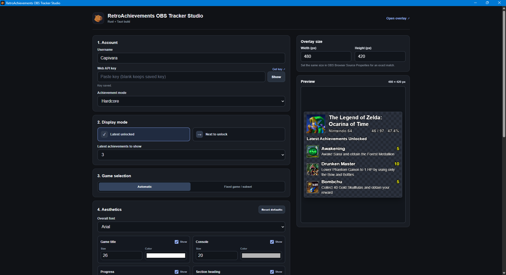
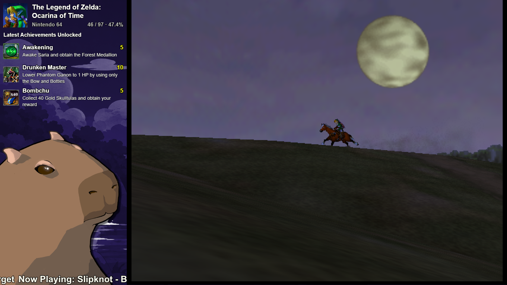

# RetroAchievements OBS Tracker Studio

A lightweight Windows desktop app (Rust + Tauri) that exposes a customizable, transparent RetroAchievements overlay URL for OBS Browser Source.





## Features

- **Automatic or Fixed Game Tracking:** Tracks your most recently played RetroAchievements game automatically, or pins a specific game ID / URL or subset URL (`?set=...`).
- **Latest or Next Mode:** Show your latest unlocked achievements or the next achievements to unlock (Hardcore or Softcore).
- **Live Aesthetics & Scaled Preview:** Customize font family, per-element sizes, colors, borders, visibility toggles, and exact OBS overlay dimensions with a live transparent-checkerboard preview.
- **System Tray & Windows Startup:** Option to minimize to the system tray on close and launch automatically minimized to the tray when Windows starts.

## Download & Setup (OBS)

1. Download the latest `*-setup.exe` installer (or portable `ra-obs-tracker.exe`) from **Releases**.
2. Launch **RetroAchievements OBS Tracker Studio**.
3. Enter your RetroAchievements **Username** and **Web API Key** (from [retroachievements.org/settings](https://retroachievements.org/settings)), configure your display/aesthetics, and click **Save & test connection**.
4. Copy the **Browser Source URL** (usually `http://127.0.0.1:8765/`).
5. In OBS Studio: **Sources → + → Browser**, paste the URL, and set **Width** and **Height** to match your configured **Overlay size**.
6. Keep the Studio app running (or minimized in the system tray) while streaming.

## Building from Source (Windows)

Requirements:
- [Rust toolchain](https://rustup.rs/)
- Tauri CLI v2:
  ```powershell
  cargo install tauri-cli --version "^2"
  ```
- Microsoft Edge WebView2 Runtime (preinstalled on Windows 10/11)

Run:
```bat
build.bat
```
This outputs:
- Installer: `src-tauri\target\release\bundle\nsis\...setup.exe`
- MSI: `src-tauri\target\release\bundle\msi\...msi`
- Portable executable: `src-tauri\target\release\ra-obs-tracker.exe`

## Creating a GitHub Release

Push a version tag matching `v*` to trigger the GitHub Actions workflow in `.github/workflows/release.yml`:

```powershell
git tag v0.1.0
git push origin v0.1.0
```

GitHub Actions will compile the release on `windows-latest` and attach the NSIS installer, MSI, and portable `ra-obs-tracker.exe` to a draft release under **Releases**.
